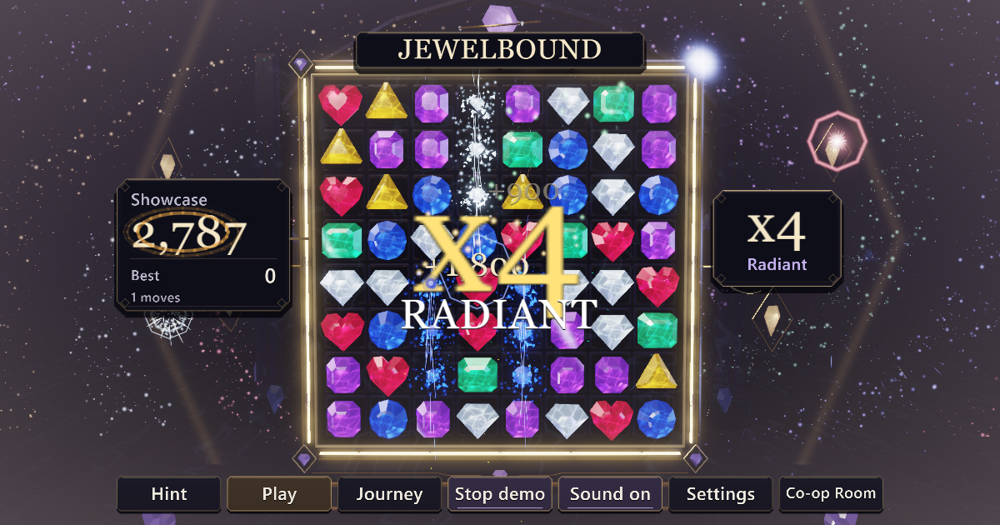

# Jewelbound

An independent branch of [Gems Together](https://github.com/TrentSterling/gemstogether) at `a611b47464c360a323ed4d41b7146321c3fdf009`, with the complete main-branch history preserved. Jewelbound 3.3.8 brings the same game into an obsidian jewelcraft vault: luminous cut crystals, antique gold, polished stone and a new interface. Rules, modes and controls are preserved, with separate saves and co-op rooms. The original deployment remains at https://tront.xyz/gemstogether/.

**Match three with the people you love.**

Play it: **https://tront.xyz/jewelbound/**

A co-op match-three game on one shared 3D jewel board. Tap a gem and its neighbour, drag, or use a controller to line up three or more. Cascades chain into combos, and bigger matches forge charged gems: blast gems that detonate their surroundings and prisms that shimmer through the spectrum.

Open the normal link and you land in the public room, on the same board as everyone else playing right now, with their cursors and grabs showing live. Co-op Room makes a private code for just the two of you. Showcase lets the board play itself.

Play opens shared Timed, 30-move, puzzle and daily challenges directly from the board. Endless stays at the heart. Journey remembers the stages you've visited and grows your cabinet treasury. High fives, team Resonance, photo mode and a best-run ghost add ways to enjoy the board together. Stages blend into the next background on the soundtrack's downbeat without pausing play; three phases add scenery and musical layers along the way.

Silver crystal, the selected tuned stereo Qwen announcer, celebrates new worlds, big chains and Resonance. Turn him off with the Announcer voice switch on the main Audio tab; music and gem sounds keep playing. Voice choices and a separate voice volume are in Audio > Announcer voices. All approved recordings retain their exact bytes; the two Gems Together welcome lines are skipped in Jewelbound.

Each world has its own musical key and chord progression. Gem tones and celebrations follow that key, while Resonance draws the music into a softer filter and opens it again for the payout. Journey > Comfort offers a separate big-combo screen flash toggle; Flashes Low limits large flash events to three per second.

Stage arrivals appear in the cabinet's title plaque, keeping the gems visible while the scenery and music change.

Timed and move-limited challenges also show a large remaining-time or moves counter in the cabinet title, with the detailed status still visible below.

Puzzle goals stay visible beside the moves counter, so the next task is clear even after the opening notice fades.

Hint outlines the suggested crystal pair and shows a small gold swap marker, including when a gem is already selected.

Short landscape screens fit the whole jewel tray above the controls, keeping the bottom row visible through cascades.

Completed challenges use a horizontal result card on compact landscape screens when it can fit clear of the controls, with readable scores and full-height continuation buttons.

Built by Tront for Jennifer. Current version: 3.3.14.

## Tech

One HTML file. The cabinet, gems and the whole interface render on the GPU (WebGPU, WebGL2 fallback with `?webgl`). Typography uses a system-font atlas generated locally at startup, with no font downloads or additional dependencies. Co-op is peer to peer over WebRTC via [Trystero](https://github.com/dmotz/trystero) (loaded from a CDN); no server of ours. Scores, settings and your optional music track stay on your device.

`python tools/polish.py` builds the single HTML from the original drop plus the hosting extensions. `tools/verify.mjs` checks the original release gate on real GPU Chrome. The feature, network, visual and transition gates are `tools/expedition-audit.mjs`, `tools/expedition-network.mjs`, `tools/expedition-visual.mjs` and `tools/expedition-stage.mjs`. Tests use solo, private rooms or random isolated public rooms.

The visual gate uses mobile emulation at 2x pixel density, actual browser touch events, finger scrolling and portrait/landscape rotation on both renderers. It also checks keyboard and controller menu navigation and input-specific panel guidance. Physical iPhone/Safari, Android and USB-controller playtests remain manual checks. Verify deployment with `node tools/verify.mjs https://tront.xyz/jewelbound/`; an optional third argument sets the expected version when checking an older build.

`tools/jewelcraft-audit.mjs` verifies the branded-audio boundary on both GPU backends. `tools/jewelcraft-capture.mjs` captures a fixed seed after a real pointer swap; `tools/jewelcraft-compare.mjs` checks that capture states match and assembles labeled side-by-side review sheets without altering the original PNGs. Local receipts stay under ignored `tools/out/`.

This project ships as a browser game on tront.xyz. The announcer pack and exact-clip listening page are documented in [tools/ANNOUNCER.md](tools/ANNOUNCER.md); the earlier engine comparisons are in [tools/VOICE-AUDITIONS.md](tools/VOICE-AUDITIONS.md).

## Credits

By Tront (Trent Sterling), built with AI coding tools. More games at [tront.xyz/games](https://tront.xyz/games/) · [Discord](https://tront.xyz/discord/)

Trystero is MIT licensed, copyright Dan Motzenbecker.
